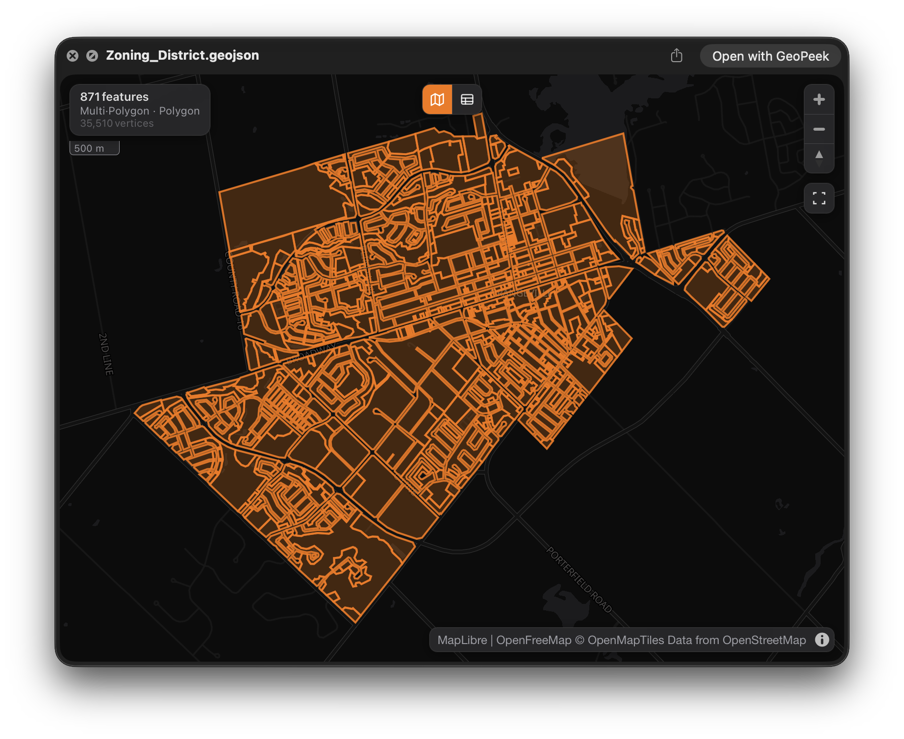
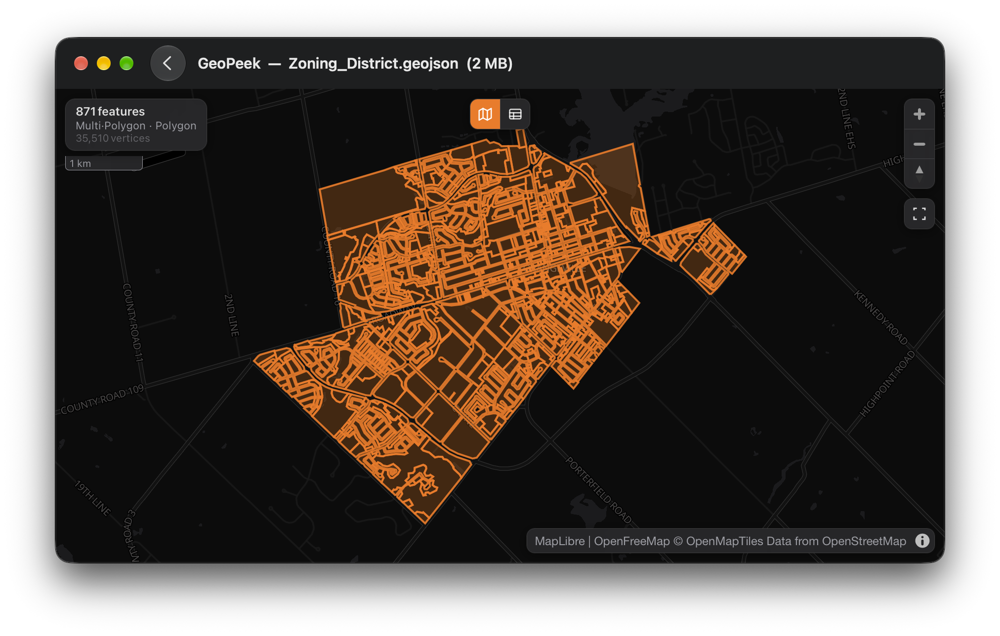
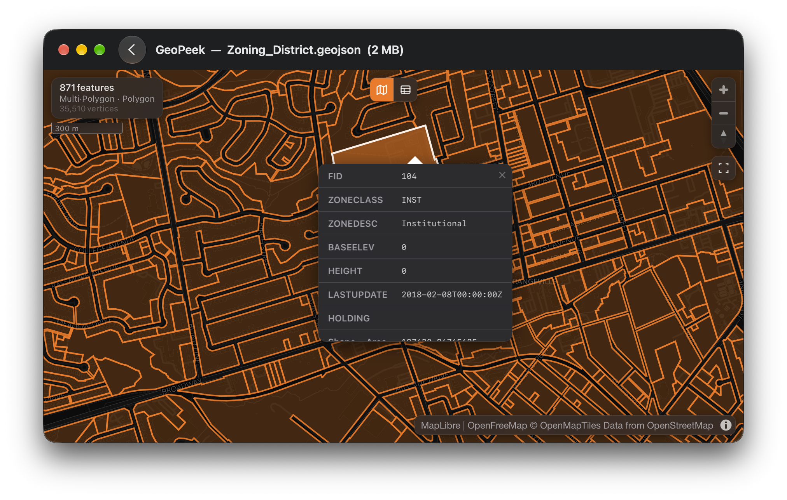
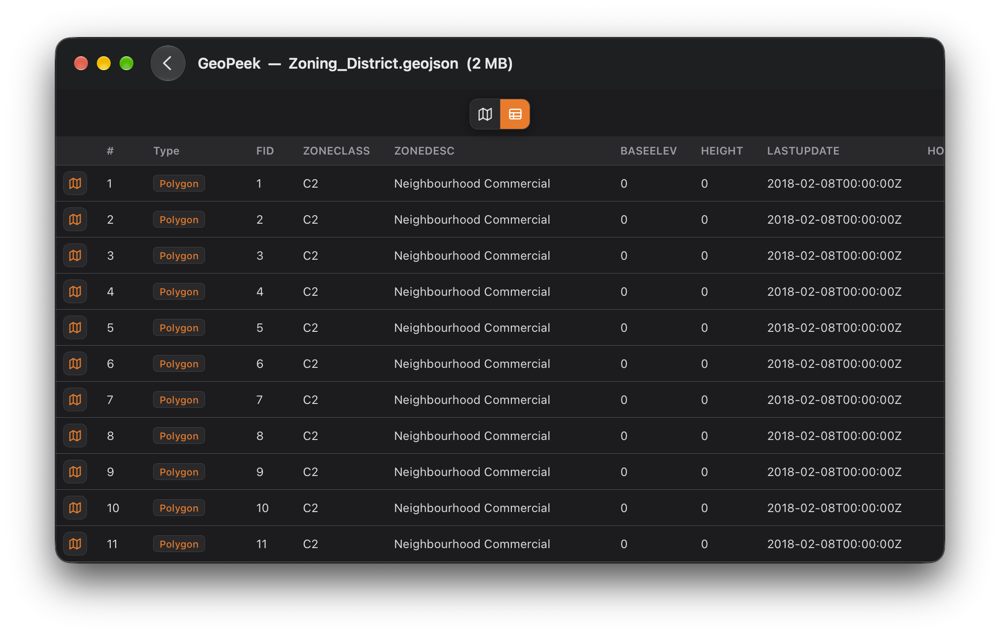
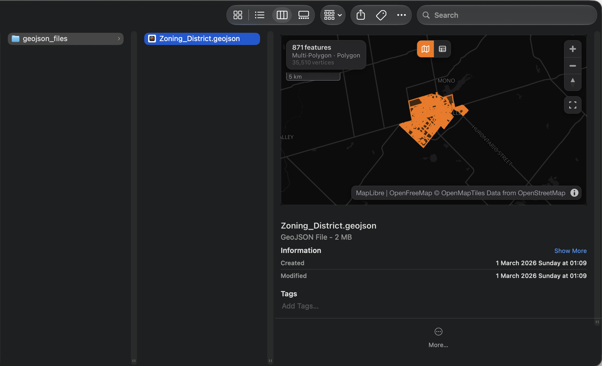

<p align="center">
  
</p>

<h1 align="center">GeoPeek</h1>

<p align="center">
  A lightweight macOS app and Quick Look extension for previewing GeoJSON, KML, KMZ, and GPX files.
</p>

<p align="center">
  <a href=".github/images/quick_look_view.png">
    
  </a>
</p>

---

## Features

- **Interactive Map** — Draws GeoJSON with MapLibre GL JS on an OpenFreeMap basemap. Dark appearance uses the `dark` style; light appearance uses `positron`. If the basemap cannot load, the map shows a "Basemap unavailable" chip and still draws the geometry on a plain background.
- **Quick Look** — Press Space in Finder on a `.geojson`, `.json`, `.kml`, `.kmz`, or `.gpx` file. A GeoJSON root opens the map. KML, KMZ, and GPX are converted to GeoJSON and drawn the same way.
- **JSON fallback** — JSON that is not GeoJSON is a read-only colored page (keys, strings, numbers, and literals). Other text is a plain dump, with a "Not valid JSON." line. A file over 5 MB shows a prefix and a truncation note. Quick Look shows this page and does not hand the file to the system JSON preview. The app uses the same page for opened or pasted text that is not GeoJSON.
- **Thumbnails** — Finder shows a static GeoPeek icon. `.geojson`, `.kml`, `.kmz`, and `.gpx` return the icon without reading the file. `.json` is sniffed for a GeoJSON root type, at most the first 8,192 bytes, and otherwise keeps the system thumbnail.
- **Paste from Clipboard** — ⌘V, or Paste from Clipboard on the welcome screen. GeoJSON text opens the map. Other text uses the JSON fallback.
- **Table View** — Toggle between the map and an attribute table of feature properties
- **Feature Selection** — Click a feature on the map to see its properties in a popup. The map button on a table row selects that feature and zooms to it.
- **Stats Panel** — Feature count, geometry types, and vertex count
- **Drag & Drop** — Open a `.geojson`, `.json`, `.kml`, `.kmz`, or `.gpx` file by dragging it onto the window
- **Error Handling** — If the app cannot read a file, it shows an error page. An empty or malformed KML, KMZ, or GPX file says it is not valid, named for that format.

## Screenshots

<table>
  <tr>
    <td align="center" width="50%">
      <a href=".github/images/map_view.png">
        
      </a>
      <br>
      Map view
    </td>
    <td align="center" width="50%">
      <a href=".github/images/selection_popup.png">
        
      </a>
      <br>
      Feature popup
    </td>
  </tr>
  <tr>
    <td align="center" width="50%">
      <a href=".github/images/table_view.png">
        
      </a>
      <br>
      Attribute table
    </td>
    <td align="center" width="50%">
      <a href=".github/images/finder_column_view.png">
        
      </a>
      <br>
      Finder column preview
    </td>
  </tr>
</table>

## Requirements

- **Running GeoPeek** — macOS 15.0 or later
- **Building from source** — Xcode 16 or later

## Installation

### Homebrew

```bash
brew install --cask serifsadi/geopeek/geopeek
```

### From GitHub Releases

Download the latest `.dmg` from [Releases](https://github.com/serifsadi/geopeek/releases).

### Build from Source

1. Clone the repository:
   ```bash
   git clone https://github.com/serifsadi/geopeek.git
   ```
2. Open `GeoPeek.xcodeproj` in Xcode
3. Build and run (`Cmd + R`)

## Usage

- **Open a file** — Double-click a `.geojson`, `.kml`, `.kmz`, or `.gpx` file, use `Cmd + O`, or drag and drop one of those or a `.json` file
- **Paste** — `Cmd + V`, or Paste from Clipboard
- **Quick Look** — Select a `.geojson`, `.json`, `.kml`, `.kmz`, or `.gpx` file in Finder and press Space
- **Toggle view** — Switch between Map and Table using the toggle button at the top center
- **Inspect features** — Click a feature on the map to see its properties in a popup. Use the map button on a table row to zoom to that feature.

## Troubleshooting

**The preview does not appear.** Open GeoPeek once. In System Settings, go to General > Login Items & Extensions > Quick Look and enable GeoPeek. Then reset Quick Look, and remove any older copies of `GeoPeek.app`:

```bash
qlmanage -r
killall QuickLookUIService
```

**Homebrew asks for trust.** Homebrew 7 does not load a third-party tap until it is trusted. `brew install --cask serifsadi/geopeek/geopeek` trusts that cask. If Homebrew asks first, trust it:

```bash
brew trust --cask serifsadi/geopeek/geopeek
```

**Basemap unavailable.** The chip means the OpenFreeMap style, or a tile, glyph, or sprite it names, did not load. The geometry stays on the plain background. The reason is in the log:

```bash
log stream --level info --predicate 'subsystem BEGINSWITH "dev.serifsadi.GeoPeek"'
```

## Tech Stack

- SwiftUI for the app (`GeoPeek/GeoPeekApp.swift`, `GeoPeek/ContentView.swift`)
- AppKit for the Quick Look and thumbnail extensions
- WebKit (WKWebView)
- [MapLibre GL JS](https://maplibre.org/) 6.18.0
- Quick Look and thumbnail extensions

## Privacy

Files are read locally and are not uploaded.

The app and the Quick Look extension are sandboxed, with read-only access to user-selected files and the network client entitlement. They request an OpenFreeMap style from `tiles.openfreemap.org`: `https://tiles.openfreemap.org/styles/dark` when the appearance is dark, and `https://tiles.openfreemap.org/styles/positron` otherwise. MapLibre then requests the tiles, glyphs, and sprites named in that style. Those style documents, and the planet TileJSON they reference, currently name only `tiles.openfreemap.org`. File contents are not included in the requests. The thumbnail extension is sandboxed with read-only access to user-selected files. Its entitlements omit the network client, and a `.geojson`, `.kml`, `.kmz`, or `.gpx` thumbnail does not open the file.

`GeoPeek/PrivacyInfo.xcprivacy`, `GeoPeekExtension/PrivacyInfo.xcprivacy`, and `GeoPeekThumbnailExtension/PrivacyInfo.xcprivacy` set `NSPrivacyTracking` to false. The tracking-domain, collected-data, and accessed-API arrays are empty. There is no analytics.

Attribution links and the MapLibre logo open in the browser.

## Releasing

Maintainers: see [RELEASING.md](RELEASING.md).

## Acknowledgements

- [MapLibre GL JS](https://maplibre.org/) 6.18.0, [BSD-3-Clause](https://github.com/maplibre/maplibre-gl-js/blob/v6.18.0/LICENSE.txt)
- Map data © [OpenStreetMap contributors](https://www.openstreetmap.org/copyright), [ODbL](https://opendatacommons.org/licenses/odbl/)
- [OpenMapTiles](https://openmaptiles.org/) schema
- [OpenFreeMap](https://openfreemap.org/)

## License

This project is licensed under the MIT License — see the [LICENSE](LICENSE) file for details.
